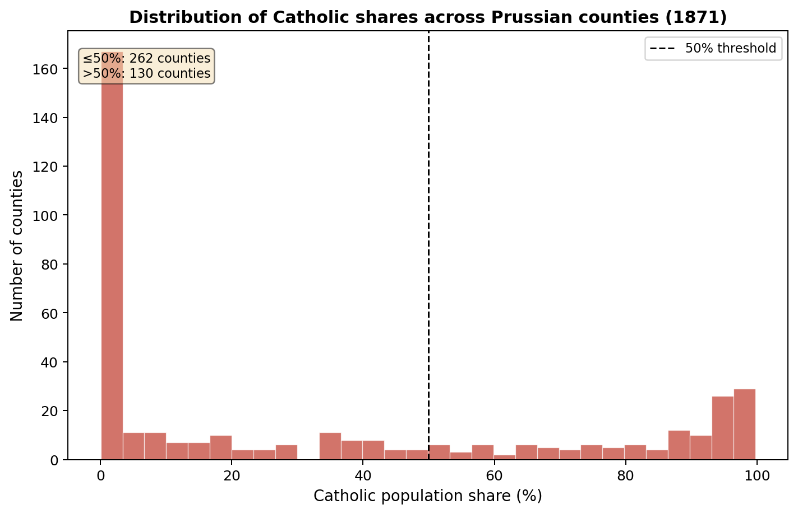

# Submitted Figure 4.1: source-level validation

Validation date: 22 October 2026. Base analysis code: `0492c2096ac217c14b1f133763b17d4afda0ebb6`.

**Result: the descriptive figure and seven related manuscript claims are reproduced, with one nearby prose discrepancy.** This is not a full-paper replication or a validation of causal interpretation.

## Reference version

Anton Meier Ebsen Jørgensen, *Bismarck’s Lost Battle: Marriage, Fertility, and the Kulturkampf in Prussia, 1867–1890*, submitted 29 May 2026. [Public paper and context](https://www.antonebsen.com/en/projects/demography-project).

The reference is Figure 4.1 on PDF page 9, with related sample and descriptive statements on PDF pages 8–10. The unchanged 45-page PDF has SHA-256:

`086a7d333c7a9b85f6476e90de30f4f3cfd76d1720996ca0aebfb532803d5e41`

## Results

Each county receives equal weight, regardless of population or years observed. Catholic share is measured in percent of the 1871 county population.

| Quantity | Submitted paper | Recomputed | Assessment |
|---|---:|---:|---|
| Counties in Figure 4.1 | 392 | 392 | Exact match |
| Catholic share ≤50% | 262 | 262 | Exact match |
| Catholic share >50% | 130 | 130 | Exact match |
| Mean Catholic share | 34% | 34.009050% | Matches stated precision |
| Median Catholic share | 13.3% | 13.332378% | Matches stated precision |
| County-year observations, 1867–1890 | 9,261 | 9,261 | Exact match of stated panel count, not outcome-specific regression samples |
| Counties without all 24 years | 33 | 33 | Exact match |
| Counties with Catholic shares between 20% and 80% | Approximately 22% | 92/392 = **23.469388%** | Prose discrepancy: about 1.47 percentage points |

No county is exactly at 20% or 80%, so including versus excluding those endpoints does not explain the discrepancy. In a future revised manuscript, use “approximately 23.5 percent (92 of 392 counties).” **The submitted PDF has not been edited.**



The reproduced plot was visually compared with the submitted figure. Thirty bin counts from an independent NumPy calculation agree exactly with the existing plotting function. This is a substantive reconstruction, not a pixel-identical PDF comparison; every original bar was not separately machine-extracted from the PDF.

## Source-to-figure procedure

1. Read `data/raw/galloway_data/REL1871.xlsx`; select `Code < 900` and `Type == 0` (393 county records). Compute `100 × (Relcathm + Relcathf) / Pop`, rejecting duplicate IDs, invalid population, missing counts, and shares outside 0–100%.
2. Read VIT1867–VIT1890, normalize column casing, and select the same county-record rules. Match to REL1871 by `Code`, then filter **actual `Year` values** to 1867–1890. Reject duplicate county-year keys and an absent calendar year; do not impute missing observations.
3. This excludes REL1871 Code 98, BRANDENBURG, which has no matching VIT county observation in the window. One matched record inside VIT1867 is labelled `Year = 1866` (Code 545, ISERLOHN): exclude it rather than relabeling it. Matching by filenames alone would give 9,262, not 9,261 observations. Recovering the stated count this way does not establish exactly which historical script produced the submitted panel.
4. Retain one religion-share observation for each of the 392 matched counties. Compute unweighted descriptive statistics and the 30-bin histogram. Independently computed shares agree with `load_rel1871()` to absolute tolerance `1e-12`; plotted counts agree with NumPy exactly.
5. VIT1875–VIT1878 each have `.XLS` and `.xlsx` files. Prefer `.xlsx`, as the existing loader does, but require exact cell equality with the alternatives (ignoring dtype). All four pairs agree. Hash all 29 source workbooks, including alternatives, before and after the check; no raw input changes.

Sources and data conditions are documented in the [data README](../data/README.md). This check does not use iPEHD, a processed panel, or later uncommitted research modules.

## Reproduce

From the repository root, in an activated Python 3.12+ environment:

```bash
python -m pip install -r exam_project2/requirements-validation.txt
python -m unittest discover -s tests -p test_figure_4_1_validation.py -v
cd exam_project2
python -m src.validation.figure_4_1
```

Optional arguments: `--data-dir PATH`, `--output-dir PATH`, and `--paper PATH`. Supplying the PDF checks its exact SHA-256; without it the numerical check runs against the recorded manuscript claims, not a freshly inspected PDF. The output directory is separate from existing analytical figures.

The local run used Python 3.14.2, NumPy 2.4.1, pandas 2.3.3, Matplotlib 3.10.8, xlrd 2.0.2, and openpyxl 3.1.5. The dedicated workflow uses Python 3.12 and the same pinned packages. Seven unit tests cover edge cases; the CLI is the real-data integration check. A successful exit means the seven matching claims pass, **not** that the approximately-22% prose claim agrees.

Local verification: all seven new unit tests passed; the full discovered test suite reported **28 passed, 5 skipped**. Skips are not successful empirical checks. Ruff passed on the new validation module and its tests. These results do not imply that the repository-wide lint/type-check or DVC workflows pass.

## Audit artifacts and limits

Under [`outputs/validation/figure_4_1/`](../outputs/validation/figure_4_1/):

- `report.json`: statistics, all 30 bin counts and edges, sample exclusions, checks, and discrepancy.
- `input_manifest.json`: selected files, conversion policy, all raw-input hashes, and relevant code hashes.
- `environment.json`: runtime and package versions for the recorded run.
- `figure_4_1_reproduced.png`: separate reproduced figure.

Rerunning overwrites only files in the selected output directory; environment and code hashes can differ between runs. This validation does **not** cover outcome denominators, interpolated population, the iPEHD crosswalk, regression coefficients, standard errors, treatment timing, parallel trends, or later 1862–1910 extensions. It supports the treatment-distribution description only; it cannot establish a causal effect or certify the full repository.
